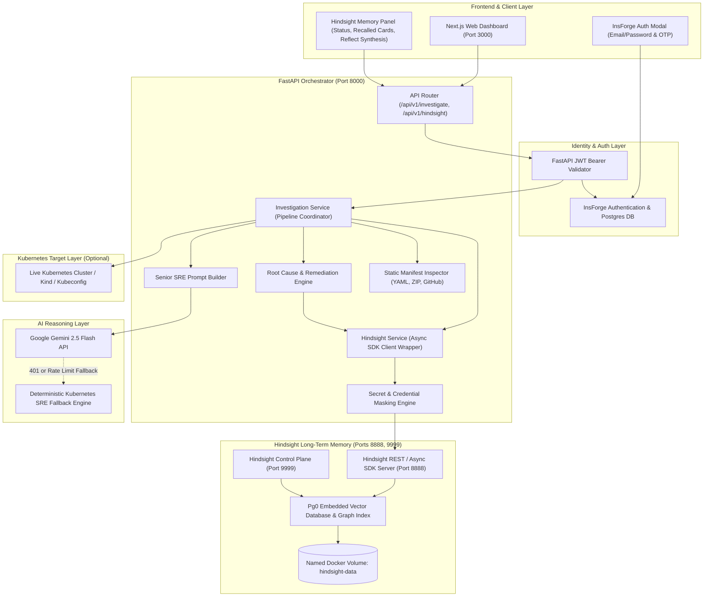
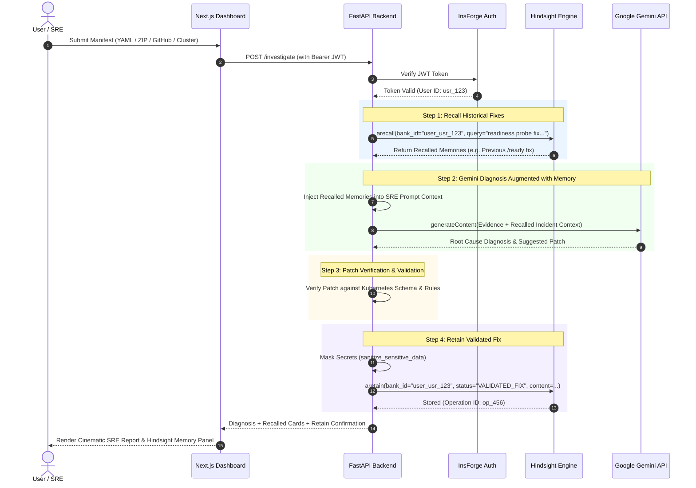
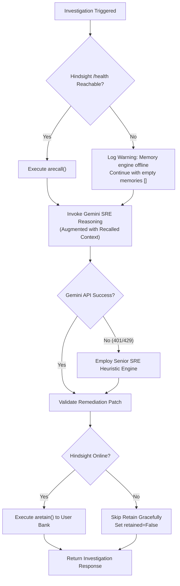

# Hindsight Agent Memory Architecture

This document details the architecture, data flow, and security boundaries of the **Hindsight** agent memory integration within the **AI Kubernetes Troubleshooting Agent / PipelineGuard AI**.

---

## 1. High-Level Component Architecture



---

## 2. Investigation Sequence Diagram (Recall → Gemini → Validate → Retain)



---

## 3. Multi-Tenant User Isolation Architecture

Hindsight memory banks are isolated by deriving bank IDs deterministically from the user's verified InsForge identity:

```text
InsForge JWT Identity: usr_alice_9876
      │
      ▼ Sanitization: re.sub(r"[^a-zA-Z0-9_-]", "_", user_id)
Bank ID: user_usr_alice_9876
      │
      ▼ Bound to:
┌──────────────────────────────────────────────┐
│  Hindsight Bank: user_usr_alice_9876         │
│  - Alice's cluster incident resolutions      │
│  - Alice's validated microservice patches     │
│  - Alice's recurring pattern reflections     │
└──────────────────────────────────────────────┘

InsForge JWT Identity: usr_bob_5432
      │
      ▼ Sanitization: re.sub(r"[^a-zA-Z0-9_-]", "_", user_id)
Bank ID: user_usr_bob_5432
      │
      ▼ Bound to:
┌──────────────────────────────────────────────┐
│  Hindsight Bank: user_usr_bob_5432           │
│  - Bob's cluster incident resolutions        │
│  - Bob's validated microservice patches       │
│  - Bob's recurring pattern reflections       │
└──────────────────────────────────────────────┘
```

**Security Guarantees:**
1. A recall executed by User Bob queries `user_usr_bob_5432` only. It has zero visibility into User Alice's bank.
2. An unauthenticated request is rejected with `401 Unauthorized` before reaching Hindsight.
3. Secret values matching password, token, or bearer regexes are redacted before leaving backend memory.

---

## 4. Offline Fallback & Resilience Flowchart


