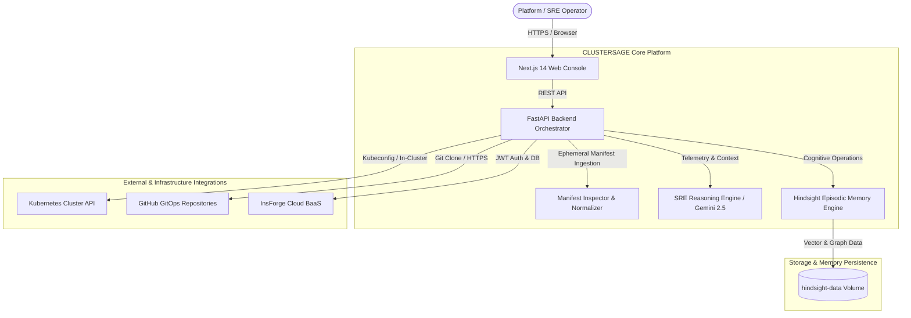
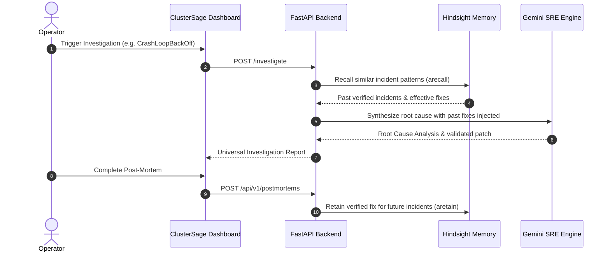

# CLUSTERSAGE

> **Intelligence for the Unstoppable Cluster.**

CLUSTERSAGE is an AI-powered Kubernetes operations intelligence platform designed to investigate infrastructure issues, identify root causes, recommend evidence-based remediation, and learn from previous incidents through persistent operational memory.

---

## 1. Key Capabilities

- **Intelligent Multi-Source Investigation**:
  - **Live Kubernetes Clusters**: Automated inspection of Pods, container crash logs, warning events, Deployment rollout deadlocks, and Service routing selectors via local kubeconfig or in-cluster ServiceAccounts.
  - **GitOps & GitHub Repositories**: Remote clone and automated static audit of Kubernetes manifests and Helm chart repositories.
  - **ZIP Archive Manifest Ingestion**: Drag-and-drop analysis of compressed multi-service manifest bundles.
  - **Raw YAML & Helm Go Templates**: Real-time syntax, API version deprecation, and probe audit with native Helm Go template placeholder (`{{ .Values... }}`) preprocessing.
- **Universal Investigation Reporting**:
  - Consistent executive summaries, overall health assessment badges, categorized issue explorers, and schema-validated fix diffs.
- **Evidence-Based Remediation**:
  - Generates copyable, dry-run validated `kubectl` commands and GitOps manifest patch diffs with blast radius evaluation.
- **Persistent Hindsight Episodic Memory**:
  - **Retain**: Permanently preserves verified incident resolutions and engineering lessons in isolated multi-tenant memory banks.
  - **Recall**: Semantic vector search and temporal BM25 scoring with `hs-rerank-1` cross-encoder reranking to surface historical incidents during active triage.
  - **Reflect**: Synthesizes recurring failure patterns and defect trends across microservices.
- **Interactive SRE Runbook Catalog & Post-Mortems**:
  - Standardized step-by-step resolution playbooks and post-mortem creation directly linked to Hindsight memory.
- **Streamlined Enterprise Settings**:
  - Minimal, high-impact operator preferences: Profile, Account & Security, Notifications, Hindsight Memory, and Data & Privacy.

---

## 2. Architecture



---

## 3. Technology Stack

| Domain | Technology | Purpose | Location |
|---|---|---|---|
| **Frontend Framework** | **Next.js 14 (App Router)** | High-performance interactive operator dashboard | `frontend/` |
| **Language (UI)** | **TypeScript / React 18** | Strict typed interfaces and component architecture | `frontend/src/` |
| **Styling & Motion** | **Tailwind CSS & Framer Motion** | Dark obsidian UI with 60fps kinetic transitions | `frontend/src/app/globals.css` |
| **Backend Framework** | **FastAPI (Python 3.12)** | Asynchronous REST API orchestrator & data normalizer | `backend/app/main.py` |
| **AI Reasoning** | **Google Gemini 2.5 Flash** | Multimodal correlation of telemetry & root cause analysis | `backend/app/ai/` |
| **Episodic Memory** | **Hindsight Memory Engine** | Multi-tenant episodic banking (Retain, Recall, Reflect) | `hindsight/` |
| **Reranker** | **hindsight-ai/hs-rerank-1** | Cross-encoder semantic reranking of past incidents | `hindsight/` |
| **Authentication & DB** | **InsForge BaaS (Postgres)** | JWT OAuth verification & incident history persistence | `frontend/src/services/insforge.ts` |
| **Kubernetes Client** | **Official Kubernetes Python Client** | Cluster discovery, pod logs, events, and API audit | `backend/app/kubernetes/` |
| **Containerization** | **Docker & Docker Compose** | Multi-stage production container orchestration | `docker-compose.yml` |

---

## 4. Repository Structure

```text
CLUSTERSAGE/
├── frontend/                     # Next.js 14 Web Dashboard
│   ├── src/                      # App router, components, services, and types
│   ├── public/                   # Static assets
│   ├── Dockerfile                # Multi-stage optimized Node 20 build
│   └── package.json
│
├── backend/                      # FastAPI Python Application
│   ├── app/                      # API routers, AI reasoning, K8s inspector, services
│   ├── tests/                    # 27 Pytest integration tests (Hindsight, runbooks, reports)
│   ├── Dockerfile                # Hardened Python 3.12 slim image with kubectl CLI
│   └── requirements.txt
│
├── hindsight/                    # Hindsight Episodic Memory Engine
│   ├── docker-compose.yml        # Standalone Hindsight deployment
│   ├── config/                   # Memory engine parameters
│   └── README.md                 # Hindsight memory deep-dive documentation
│
├── infrastructure/               # Infrastructure & Deployment Assets
│   ├── docker/                   # Container topology & multi-stage build notes
│   ├── kubernetes/               # RBAC policies & 5 failure triage scenarios
│   └── deployment/               # High-availability production guidelines & NGINX config
│
├── docs/                         # Comprehensive Documentation
│   ├── architecture.md           # System context, data flow, component breakdown
│   ├── installation.md           # Step-by-step local & Docker installation guide
│   ├── configuration.md          # Environment variable reference
│   ├── deployment.md             # Production deployment & volume management
│   ├── hindsight-integration.md  # Retain, Recall, and Reflect workflows
│   ├── api-reference.md          # OpenAPI REST endpoint specifications
│   ├── security.md               # Secret sanitization & token scrubbing policy
│   └── troubleshooting.md        # Common diagnostics and fixes
│
├── scripts/                      # Developer & Operational Automation
│   ├── setup.sh                  # Local environment initialization
│   ├── start.sh                  # Automated multi-container startup
│   ├── health-check.sh           # Endpoint verification script
│   └── test_scenarios.py         # Automated scenario verification
│
├── .github/                      # CI/CD Workflows & Governance
│   ├── workflows/                # GitHub Actions (CI & Security scanning)
│   ├── ISSUE_TEMPLATE/           # Bug report & feature request templates
│   ├── PULL_REQUEST_TEMPLATE.md  # Standardized pull request review template
│   └── dependabot.yml            # Automated weekly dependency updates
│
├── .env.example                  # Environment configuration template
├── .gitignore                    # Comprehensive repository exclusion rules
├── .dockerignore                 # Root and service build context filters
├── .editorconfig                 # Standardized editor indentation and line endings
├── .gitattributes                # Git text normalization
├── CONTRIBUTING.md               # Contributor guidelines and testing rules
├── CODE_OF_CONDUCT.md            # Contributor Covenant v2.1
├── SECURITY.md                   # Security vulnerability reporting & CVE policies
├── CHANGELOG.md                  # Release history following Keep a Changelog standard
├── Makefile                      # Cross-platform developer automation commands
└── README.md                     # Project title, overview, and quickstart guide
```

---

## 5. Getting Started

### Prerequisites
- Docker 24.0+ & Docker Compose v2.20+
- Google Gemini API Key ([Get one free from Google AI Studio](https://aistudio.google.com/))

### Quickstart (3 Commands)

```bash
# 1. Clone the repository
git clone https://github.com/ClusterSage/ClusterSage.git
cd ClusterSage

# 2. Configure environment
cp .env.example .env
# Edit .env and supply your GEMINI_API_KEY=AIzaSy...

# 3. Launch the container stack
docker compose up -d --build
```

### Access Points
- **Web Dashboard**: `http://localhost:3000`
- **Backend API Docs**: `http://localhost:8000/docs`
- **Memory Control Plane**: `http://localhost:9999`

---

## 6. Environment Configuration

All settings are configured via `.env` (derived from `.env.example`). Key configuration variables:

```dotenv
# Google Gemini Reasoning Engine (Server-Only)
GEMINI_API_KEY=AIzaSy...your_gemini_api_key_here
GEMINI_MODEL=gemini-2.5-flash

# InsForge BaaS & Persistent Database
INSFORGE_URL=https://mucsd7yw.us-east.insforge.app
INSFORGE_ANON_KEY=anon_57cbe317689f3e724ced0051c10d088eab9ddc1123ce564702735a7dcb764eb8

# Hindsight Episodic Memory Engine
HINDSIGHT_URL=http://localhost:8888
HINDSIGHT_CONTROL_PLANE_URL=http://localhost:9999
HINDSIGHT_API_LLM_PROVIDER=gemini

# Frontend Public Gateway
NEXT_PUBLIC_API_BASE_URL=http://localhost:8000
```

Refer to [`docs/configuration.md`](docs/configuration.md) for full parameter descriptions.

---

## 7. Hindsight Episodic Memory Workflows

ClusterSage uses Hindsight to give SRE teams persistent episodic memory:



- **Retain**: Records verified post-mortem fixes and lessons learned into the user's isolated memory bank.
- **Recall**: Retrieves matching historical incidents using hybrid semantic vector and BM25 scoring.
- **Reflect**: Synthesizes recurring failure patterns across historical incidents.

Refer to [`docs/hindsight-integration.md`](docs/hindsight-integration.md) for architectural details.

---

## 8. Testing & Quality Verification

Run the full backend integration test suite:

```bash
cd backend
pytest tests/ -v
# Output: 27 passed in ~100s
```

Run the frontend production build check:

```bash
cd frontend
npm run build
# Output: Compiled successfully, 0 type errors
```

---

## 9. Security & Privacy

- **Deterministic Regex Secrets Scrubber**: All AWS/GCP keys, Bearer tokens, and passwords are sanitized before transmission to AI models.
- **Zero Third-Party Telemetry**: ClusterSage does not transmit cluster metrics to third-party ad networks.
- **Multi-Tenant Isolation**: Memory banks are partitioned strictly by authenticated user ID.

Refer to [`docs/security.md`](docs/security.md) for the complete security specification.

---

## 10. Contributing

Contributions are welcome! Please read [`CONTRIBUTING.md`](CONTRIBUTING.md) for our pull request process, branching strategy, and code conventions. Please review [`CODE_OF_CONDUCT.md`](CODE_OF_CONDUCT.md) before participating.

---

## 11. License

See the LICENSE section or project repository settings for licensing terms.
