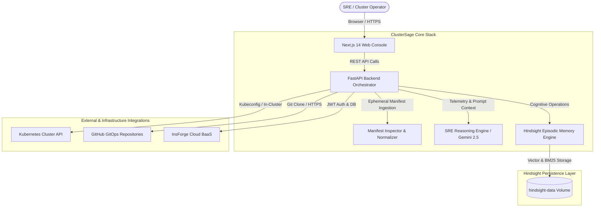

# System Architecture — ClusterSage

ClusterSage is an autonomous AI-powered Kubernetes operations intelligence platform. It ingests cluster telemetry and manifests from multiple sources, correlates evidence using Google Gemini, consults an isolated episodic memory engine (Hindsight), and generates standardized investigation reports with executable fixes.

---

## 1. High-Level System Architecture

---

## 2. Component Breakdown

### 2.1 Next.js 14 Frontend (`frontend/`)
- **Technology**: React 18, Next.js 14 App Router, Tailwind CSS, Framer Motion.
- **Role**: Operator workstation providing:
  - **Investigation Command Center**: Unified ingestion across live clusters, GitHub repositories, ZIP archives, and plain YAML manifests.
  - **Universal Report View**: Executive summaries, health badges, categorized issue explorers, and remediation diffs.
  - **Memory Bank Browser**: Real-time inspection of retained incident memories.
  - **Runbook Catalog & Post-Mortem Workflows**: Standardized incident resolution knowledge bases.
  - **Enterprise Settings**: 5 streamlined categories (Profile, Account & Security, Notifications, Hindsight Memory, Data & Privacy).

### 2.2 FastAPI Backend Orchestrator (`backend/`)
- **Technology**: Python 3.12, FastAPI, Uvicorn, Pydantic v2.
- **Role**: Coordinates investigation workflows, cluster discovery, and LLM prompt generation:
  - `app/api/v1/`: Modular API routers for health, clusters, investigations, Hindsight, runbooks, and post-mortems.
  - `app/kubernetes/`: Cluster manager using official `kubernetes` client and `manifest_inspector.py` with Helm template expression preprocessing.
  - `app/services/report_normalizer.py`: Normalizes diverse diagnostic outputs into a single typed `UniversalInvestigationReport`.
  - `app/services/hindsight_service.py`: Multi-tenant memory management using `hindsight-client`.

### 2.3 Google Gemini AI SRE Engine
- **Model**: `gemini-2.5-flash` (or `gemini-2.0-flash`).
- **Prompt Architecture**: High-speed multimodal correlation prompt incorporating:
  - Live container logs, warning events, and resource limits.
  - Extracted YAML manifest AST and Helm Go template placeholders.
  - Recalled historical incident resolutions retrieved from Hindsight.
  - Deterministic regex secrets scrubber redacting tokens, keys, and passwords before transmission.

### 2.4 Hindsight Episodic Memory Engine (`hindsight/`)
- **Container**: `ghcr.io/vectorize-io/hindsight:latest`.
- **Role**: Provides long-term episodic memory to ensure previous incident fixes are retained and recalled during active triage.
- **Isolation**: Tenant memory banks partitioned strictly by authenticated user ID.

### 2.5 InsForge BaaS (`https://mucsd7yw.us-east.insforge.app`)
- **Role**: Cryptographic JWT authentication, user profile persistence, and PostgreSQL storage for investigation records.
