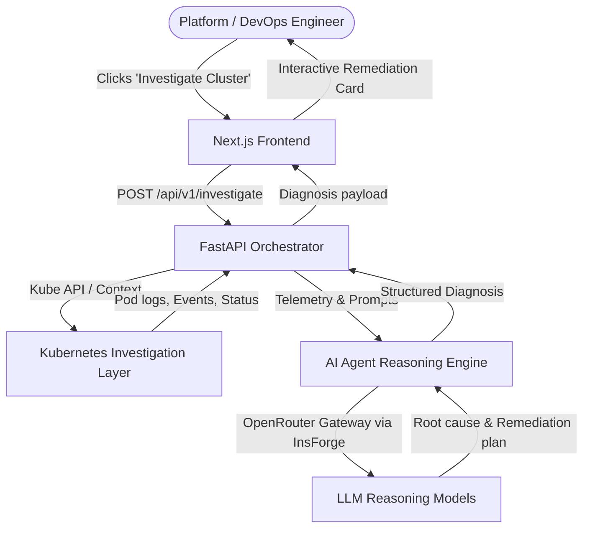

# Architecture Overview - AI Kubernetes Troubleshooting Agent

## 1. System Context & Intent
The **AI Kubernetes Troubleshooting Agent** is an on-demand diagnosis and remediation recommendation system for Kubernetes clusters. 

It is designed to be triggered on-demand (e.g., via the web dashboard when an engineer suspects cluster instability), rather than acting as a continuous autonomous controller/operator.



## 2. Monorepo Organization
```text
ai-kubernetes-agent/
├── backend/                  # FastAPI Application Orchestrator
│   ├── app/
│   │   ├── api/              # API routers and endpoints (v1)
│   │   ├── core/             # Configuration, logging, lifecycle
│   │   ├── kubernetes/       # Cluster discovery, log fetching, event parsing
│   │   ├── ai/               # Prompt templates and LLM integration
│   │   ├── services/         # Orchestration & troubleshooting workflows
│   │   ├── models/           # Pydantic schemas and domain models
│   │   └── main.py           # FastAPI entrypoint & middleware
│   ├── Dockerfile
│   └── requirements.txt
├── frontend/                 # Next.js Web UI
│   ├── src/
│   │   ├── app/              # Next.js App Router (pages & layout)
│   │   ├── components/       # Reusable UI components
│   │   ├── services/         # Axios API clients
│   │   ├── hooks/            # TanStack React Query hooks
│   │   └── types/            # TypeScript interfaces & data contracts
│   ├── Dockerfile
│   └── package.json
├── docs/                     # Architecture & operational guides
├── prompts/                  # Stored development prompts & guidelines
└── docker-compose.yml        # Unified container development environment
```

## 3. Communication Contracts
- **Health Check**: `GET /health` -> `{ "status": "healthy", "service": "ai-kubernetes-agent" }`
- **Investigation Endpoint (Placeholder)**: `POST /api/v1/investigate`
