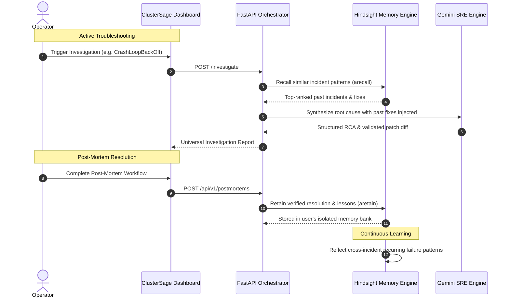

# Hindsight Episodic Memory Integration — ClusterSage

ClusterSage integrates **Hindsight**, an autonomous episodic memory engine, to give SRE operators **long-term cognitive memory across cluster outages, manifest misconfigurations, and post-mortems**.

---

## 1. Why Episodic Memory for Kubernetes SRE?

Standard Kubernetes troubleshooting tools operate statelessly: when an incident occurs, an engineer starts from scratch, re-searching StackOverflow, Slack, or Jira.

ClusterSage uses Hindsight to treat operational experience as permanent institutional memory:
1. **Never repeat root-cause analysis** for incidents that have already been diagnosed.
2. **Surface battle-tested fixes** that worked on this specific microservice in past incidents.
3. **Prevent anti-patterns** by recalling previous failed attempts.

---

## 2. Core Workflows: Retain, Recall, Reflect

### 2.1 Retain
When a post-mortem is retained, ClusterSage persists:
- The exact failure symptoms (e.g., container exit codes, warning events).
- The root cause hypothesis verified by the operator.
- The exact patch or `kubectl` command that resolved the issue.
- Reusable lessons learned to prevent future recurrence.

### 2.2 Recall
During active triage of a new incident, ClusterSage queries Hindsight using a hybrid search combining **Temporal BM25** and semantic vector similarity, reranked by `hs-rerank-1`. The highest-scoring historical resolutions are injected directly into the Gemini reasoning prompt.

### 2.3 Reflect
Hindsight periodically analyzes accumulated memories to extract meta-patterns across incidents, such as:
- A specific deployment repeatedly failing readiness probes after memory spikes.
- Repeated CPU throttling caused by overly strict requests without limit headroom.

---

## 3. Tenant Bank Isolation

Memory banks in ClusterSage are partitioned by authenticated user ID:
- Authenticated user `usr_abc123` interacts strictly with bank `user_usr_abc123`.
- Unauthenticated requests safely route to `bank_default_cluster_sre`.
- Cross-tenant memory access is prevented at the routing layer.
