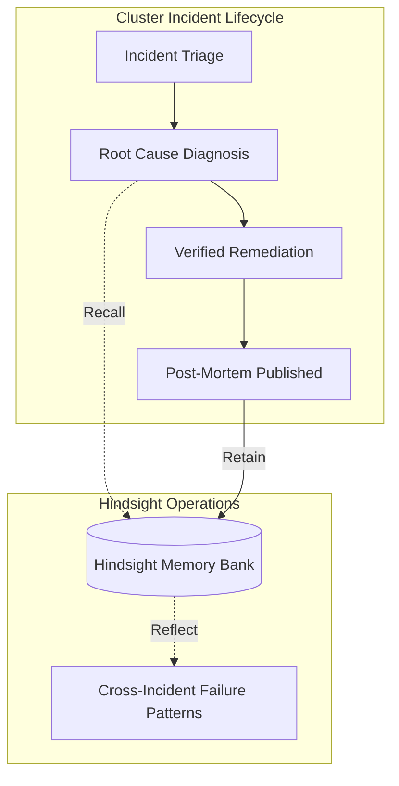

# Hindsight Episodic Memory Engine

Hindsight is an autonomous episodic memory engine embedded into ClusterSage to give SRE operators **long-term cognitive memory across cluster outages, manifest misconfigurations, and post-mortems**.

Instead of diagnosing repetitive failures from scratch, ClusterSage automatically retains lessons from verified incidents, recalls similar historical cases during active troubleshooting, and synthesizes recurring architectural failure patterns.

---

## 1. Core Memory Operations



- **Retain**: Records verified post-mortems, root causes, effective patches, and failed attempts into the operator's dedicated memory bank.
- **Recall**: Performs semantic search and temporal BM25 scoring with `hs-rerank-1` cross-encoder reranking to surface previous incidents relevant to the active failure symptoms.
- **Reflect**: Periodically analyzes accumulated memories to synthesize systemic defect patterns (e.g. repeated probe timeouts across microservices or recurring OOM kills).

---

## 2. Standalone Deployment

To start Hindsight as an independent service:

```bash
docker compose -f hindsight/docker-compose.yml up -d
```

### Endpoints
- **REST API**: `http://localhost:8888`
- **Health Check**: `http://localhost:8888/health`
- **Control Plane Web UI**: `http://localhost:9999`

---

## 3. Python SDK Integration

ClusterSage communicates with Hindsight through `hindsight-client`:

```python
from hindsight_client import HindsightClient

client = HindsightClient(base_url="http://localhost:8888")

# Retain incident
await client.aretain(
    bank_id="user_tenant_01",
    content="Production deployment auth-service failed with CrashLoopBackOff due to missing JWT_SECRET environment variable.",
    tags=["crashloop", "env-var-missing", "auth-service"]
)

# Recall relevant incident
results = await client.arecall(
    bank_id="user_tenant_01",
    query="CrashLoopBackOff container terminated exit code 1",
    budget=5
)
```

---

## 4. Multi-Tenant Bank Partitioning

Each operator's memories are partitioned by authenticated user ID. This ensures:
- Strict multi-tenant security boundary.
- Zero cross-operator data leakage.
- Independent reflection patterns per development team.
