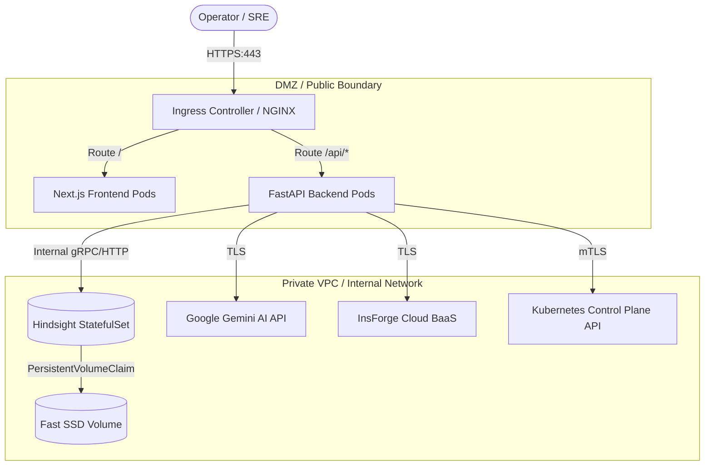

# Production Deployment Architecture

This document outlines deployment architectures, reverse proxying, and hardening guidelines for deploying ClusterSage in production.

---

## 1. High-Availability Production Architecture

---

## 2. Hardening & Security Best Practices

1. **Secrets Management**:
   - Store `GEMINI_API_KEY` and `INSFORGE_ANON_KEY` as Kubernetes Secrets or inject via HashiCorp Vault / AWS Secrets Manager.
   - Never bake API keys into Docker image layers or commit `.env` files.

2. **TLS Termination**:
   - Always terminate TLS 1.3 at your edge Ingress controller (e.g. `cert-manager` with Let's Encrypt).
   - Configure HSTS (`Strict-Transport-Security: max-age=63072000; includeSubDomains; preload`).

3. **CORS Restrictions**:
   - Limit `CORS_ORIGINS` to the exact public domain of your frontend (e.g. `["https://clustersage.internal.company.com"]`).

4. **Resource Quotas**:
   - Frontend: Request `250m` CPU / `512Mi` Memory, Limit `1000m` CPU / `1Gi` Memory.
   - Backend: Request `500m` CPU / `1Gi` Memory, Limit `2000m` CPU / `2Gi` Memory.
   - Hindsight: Request `1000m` CPU / `2Gi` Memory, Limit `4000m` CPU / `8Gi` Memory (with `shm_size: 1gb`).
