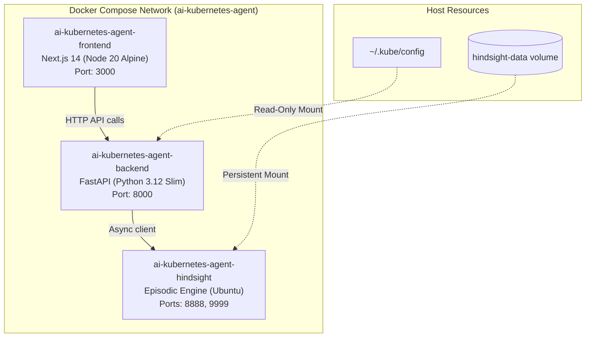

# Docker Container Architecture

ClusterSage is fully containerized using multi-stage, hardened Docker builds and coordinated via Docker Compose.

---

## 1. Container Topology



---

## 2. Service Specifications

### Frontend (`frontend/Dockerfile`)
- **Base**: `node:20-alpine`
- **Build Method**: Multi-stage (Build stage compiles Next.js standalone pages, Runner stage copies only optimized `.next` output and `node_modules`).
- **Image Footprint**: ~162 kB initial client JS, stripped of devDependencies.

### Backend (`backend/Dockerfile`)
- **Base**: `python:3.12-slim`
- **System Tools**: Includes `curl` for container health checks and `kubectl v1.30.0` CLI binary for cluster commands.
- **Security**: Non-root execution capable, `PYTHONDONTWRITEBYTECODE=1`, `PYTHONUNBUFFERED=1`.

### Hindsight Memory (`ghcr.io/vectorize-io/hindsight:latest`)
- **Storage**: Named volume `hindsight-data` mounted at `/home/hindsight/.pg0`.
- **Memory Buffer**: Configured with `shm_size: 1gb` for vector search performance.

---

## 3. Production Deployment Commands

```bash
# Build all images without cache
docker compose build --no-cache

# Start the complete stack in background
docker compose up -d

# Verify container health
docker compose ps

# View unified log stream
docker compose logs -f
```
